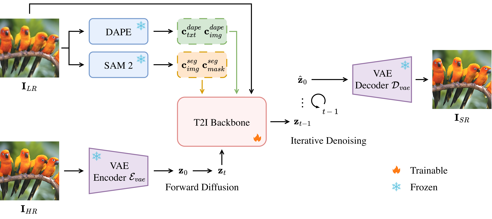

# SegESR: Segmentation Enhanced Super-Resolution

> **SegESR** is an advanced image super-resolution diffusion framework that leverages the power of a foundational segmentation model. Building upon the foundation of [SeeSR](https://github.com/cswry/SeeSR), this project introduces novel architectural improvements and optimization strategies to enhance generation quality and efficiency.

---

## 📄 Abstract
> Diffusion-based Image Super-Resolution (ISR) models achieve remarkable perceptual quality but often suffer from structural hallucinations. Specifically, existing semantic-aware methods rely on high-level tags or text prompts that inherently lack fine-grained geometric information. In this work, we propose *Segmentation Enhanced Super-Resolution* (SegESR), a novel framework leveraging the hierarchical layout-preserving features of a foundational segmentation model, alongside text, to construct a robust structural scaffold for the restoration process. To effectively integrate these priors, we introduce the *Parallel Attention Fusion Block* (PAFB). This module disentangles semantic and spatial conditions, injecting them via a parallel stream architecture. Furthermore, we design a perceptual loss optimized directly within the pre-trained segmentation feature space. Extensive experiments demonstrate that SegESR effectively mitigates hallucinations, achieving state-of-the-art synthetic fidelity (+2.22 dB PSNR, +0.06 SSIM) and competitive real-world perceptual quality (+0.008 CLIPIQA).

---

## 🧩 Architecture Overview


## 🔎 Key Innovations

Unlike traditional super-resolution methods, SegESR integrates segmentation-aware priors to guide the diffusion process. Key contributions include:

* **SAM 2-Guided Generation**: Introduced two new semantic priors derived from SAM 2:
    * **SICA (SAM Image Cross-Attention)**: Attends to the last stage of the SAM 2 [Hiera encoder](https://huggingface.co/docs/transformers/model_doc/hiera) on the LR image upsampled ×4 (bicubic) (1152 channels, 1/32 of the 1024×1024 SAM 2 input).
    * **SMCA (SAM Masks Cross-Attention)**: Attends to the soft mask map of the same image: the logits of the N ≤ 150 largest SAM 2 masks (point grid, stability score > 0.9), upsampled to 128×128 and aggregated by a pixel-wise maximum.
* **Parallelized PAFB Architecture**: Introduced the *Parallel Attention Fusion Block (PAFB)*. Text, image embeddings and segmentation embeddings are now processed in **parallel** and fused via a trainable convolutional layer, streamlining the information flow compared to sequential approaches.
* **SAM 2 Perceptual Loss**: Integrated a new perceptual loss function based on the SAM 2 feature space, supplementing the standard MSE diffusion loss to improve semantic consistency in the super-resolved output.
* **Memory Optimization**: The architecture is optimized for consumer-grade hardware (e.g., NVIDIA RTX 4090), significantly reducing VRAM usage without compromising performance.

## 🛠️ Installation

The environment can be set up using standard Python package management.

1.  **Clone the repository**
    
2.  **Create an environment**
      ```bash
      conda create -n segesr python=3.10
      conda activate segesr
      ```
    
3.  **Install dependencies**
    ```bash
    pip install -r requirements.txt
    pip install git+https://github.com/facebookresearch/sam2.git   # SAM 2.1
    pip install -e .                                               # segesr + vendored ram / basicsr
    ```

    *Note: If you are using xformers for memory efficiency, ensure it is compatible with your PyTorch/CUDA version.*

    The scripts also work without `pip install -e .` when launched from the repository root.

4.  **Run the tests** (optional)
    ```bash
    pytest
    ```

## 🚀 Inference
#### Download the pretrained models
- Download the pretrained SD-2-base model.
- Download the SeeSR, DAPE, RAM, Tiny VAE and SAM 2 models.
- Download the test datasets (DIV2K-Val, RealLR200, RealSR and DRealSR).

You can put the models into `preset/models`, the test datasets into `preset/datasets/test_datasets` and then run:

```bash
./scripts/run_test.sh preset/train_output/segesr          # every checkpoint-* of a run, all test datasets + metrics
```

or, for a single checkpoint and folder of LR images:

```bash
python test.py --config configs/test_default.yaml \
--finetuned_model_path preset/train_output/segesr/checkpoint-XXXX \
--image_path preset/datasets/test_datasets/RealSR/test_LR \
--output_dir preset/datasets/output/RealSR
```

SAM 2.1 weights are downloaded from the Hugging Face Hub (`facebook/sam2.1-hiera-large`) on first use.

The architecture is read from the checkpoint, so `test.py` works the same for the SeeSR baseline (`--finetuned_model_path preset/models/seesr`) and for any SegESR variant. SAM 2 runs once per image, on the LR input upsampled ×4 with bicubic interpolation (the ControlNet input), as for the training data.

## 🌈 Train 
#### Step 1: Prepare training data
Pre-prepare training data pairs for the training process, which would take up some memory space but save training time. SegESR is trained with 15% of [LSDIR](https://huggingface.co/ofsoundof/LSDIR) randomly sampled + the first 5K images of [FFHQ](https://huggingface.co/datasets/marcosv/ffhq-dataset), as in the paper (Sec. 4.1). Put the sampled LSDIR images and the FFHQ images into `preset/datasets/train_datasets/LSDIR/finetune_subset`.

The whole pipeline (degraded pairs, RAM tags, DAPE embeddings, SAM 2 embeddings and mask logits of the LR images) can be run with:

```bash
./scripts/prepare_data.sh preset/datasets/train_datasets/LSDIR/finetune_subset preset/datasets/train_datasets/LSDIR
```

or step by step with the scripts in `data_tools/`:

```bash
python data_tools/make_paired_data.py --gt_path preset/datasets/train_datasets/LSDIR/finetune_subset --save_dir preset/datasets/train_datasets/LSDIR --epoch 1
python data_tools/make_tags.py --root_path preset/datasets/train_datasets/LSDIR
python data_tools/make_dape_embeds.py --image_dir preset/datasets/train_datasets/LSDIR/sr_bicubic --embed_dir preset/datasets/train_datasets/LSDIR/dape_embeds --ram_ft_path preset/models/DAPE.pth
python data_tools/sam_processing.py --image_dir preset/datasets/train_datasets/LSDIR/sr_bicubic --embed_dir preset/datasets/train_datasets/LSDIR/sam_embeds --logit_dir preset/datasets/train_datasets/LSDIR/seg_embeds
```

- `--gt_path` the path of gt images. If you have multi gt dirs, you can set it as `PATH1 PATH2 PATH3 ...`
- `--save_dir` the path of paired images 
- `--epoch` the number of epoch you want to make

`make_paired_data.py` randomly crops a sub-image with a resolution of 512.

The data folder should be like this (files are matched by name):

```
your_training_datasets/
    └── gt
        └── 0000001.png # GT images, (512, 512, 3)
    └── sr_bicubic
        └── 0000001.png # bicubic-upsampled LR images, (512, 512, 3)
    └── lr
        └── 0000001.png # LR images, (128, 128, 3)
    └── tag
        └── 0000001.txt # tag prompts
    └── dape_embeds
        └── 0000001.pt  # DAPE image embeddings
    └── sam_embeds
        └── 0000001.pt  # last Hiera stage of SAM 2 on the sr_bicubic image, (1, 1152, 32, 32)
    └── seg_embeds
        └── 0000001.pt  # SAM 2 mask decoder logits on the sr_bicubic image, (N, 1, 256, 256)
```


#### Step 2: Training SegESR

SegESR is trained in two stages, as in the ECCV 2026 paper:

```bash
./scripts/run_train.sh configs/train_segesr.yaml          # stage 1: new modules only, 20K steps, lr 9e-7
./scripts/run_train.sh configs/train_segesr_stage2.yaml   # stage 2: + DAPE attentions, 28K steps, lr 2e-7 / 5e-7
./scripts/run_train.sh configs/train_seesr.yaml           # SeeSR baseline, fine-tuned on the same data
```

Both stages use batch 1 × 4 accumulation steps, bf16 and the SAM 2 perceptual loss with λ = 0.1, computed on the SD VAE decoding of the predicted x₀; stage 2 starts from the last stage 1 checkpoint. The training data is a random 15% of LSDIR plus the first 5K FFHQ images.

Details the paper leaves open, and how the code fills them: SMCA reads the 128×128 map as 128 tokens (one per row); H×W of Eq. 3 is 128×128 at test time too, whatever the LR size; the SAM 2 loss compares the SAM 2 image encoder outputs (after the FPN neck) as a mean squared error, like the diffusion loss; the SAM 2 attentions start from the DAPE attention weights (zero-padded to 1152 input channels for SICA); the fusion conv starts as the average of its four branches; the "pre-trained layers" of stage 2 are the DAPE attentions. Every key of the YAML config is a `train.py` argument, and flags passed on the command line override the config (e.g. `--max_train_steps=1000`). The SegESR configs add the SegESR components to `configs/train_seesr.yaml` (`base_config` key), so each component can be switched on one at a time, as in the ablation of the paper:

| Variant | Component | Training flags added to `configs/train_seesr.yaml` |
|---|---|---|
| SeeSR | text → DAPE attention, sequential | — |
| V1 | PAFB: parallel attentions + fusion conv | `--attention_fusion=parallel` |
| V2 | + SICA (SAM 2 image embeddings) | V1 + `--use_sam2_image_attention` |
| V3 | + SMCA (SAM 2 mask logits) | V2 + `--use_sam2_segmentation_attention` |
| SegESR | + SAM 2 perceptual loss | V3 + `--use_sam_loss` |

Give each run its own `--output_dir`. The architecture flags are stored in the checkpoint configs, and `test.py` rebuilds the model from them. The fusion conv starts as the average of its branches.

## 🖥️ SLURM cluster

`cluster/` contains SLURM jobs that run everything inside the `pytorch/pytorch:2.6.0-cuda12.6-cudnn9-devel` Singularity container, with a virtual environment in `~/venvs/segesr` (`requirements-cluster.txt`). Submit them from the repository root; logs go to `slurm_logs/`.

```bash
sbatch cluster/setup_env.sh                                   # once: container, packages, SAM 2.1 weights, tests
sbatch cluster/download_models.sh                             # once: SD 2 base, SeeSR + DAPE, RAM, tiny VAE
sbatch cluster/download_datasets.sh                           # once: test sets, LSDIR + FFHQ training subset
sbatch cluster/prepare_data.sh preset/datasets/train_datasets/LSDIR/finetune_subset preset/datasets/train_datasets/LSDIR
sbatch cluster/train.sh configs/train_segesr.yaml           # stage 1
sbatch cluster/train.sh configs/train_segesr_stage2.yaml    # stage 2, after stage 1
sbatch cluster/test.sh preset/train_output/segesr_eccv
```

Edit the `#SBATCH` lines (partition, QOS, memory) for another cluster.

**TensorBoard.** Every run logs to `tensorboard/<run>/train` (losses, learning rate, gradient norm, seconds per step, peak GPU memory, validation samples), and `run_test.sh` adds `tensorboard/<run>/test` (all metrics and a few SR | GT images, at the training step of each checkpoint). `sbatch cluster/tensorboard.sh` starts TensorBoard on the cluster; its log prints the SSH tunnel command to run on your computer.

`data_tools/download_data.py` (run by `cluster/download_models.sh` and `cluster/download_datasets.sh`, or directly) downloads everything into `preset/` except RealLR200, which is only on [Google Drive](https://drive.google.com/drive/folders/1L2VsQYQRKhWJxe6yWZU9FgBWSgBCk6mz). LSDIR is gated: accept its terms at [huggingface.co/ofsoundof/LSDIR](https://huggingface.co/ofsoundof/LSDIR) and save a read token in `~/.cache/huggingface/token` first. The full LSDIR (~155 GB) is kept in `preset/datasets/LSDIR_full` unless `--delete_full_lsdir` is passed.

## Other directions

After step 0.1 the segmentation track was put on hold and other directions were tried; they are closed, their code
is in `archive/` and their models and outputs on the cluster are in `preset/archive/`.

- [docs/ROADMAP.md](docs/ROADMAP.md): the directions, their steps and the decisions taken at each gate.
- [docs/EXPERIMENTS.md](docs/EXPERIMENTS.md): every job with its commit, flags and metrics.
- [docs/ARCHIVE.md](docs/ARCHIVE.md): where the code, models and results of each closed direction are.

## Shared tools and baselines

| Path | Content |
|---|---|
| `data_tools/metrics.py` | Full-reference and no-reference metrics of an SR output folder (`metrics/<dataset>/results_<name>.json`) |
| `data_tools/fine_structure.py` | Per-band PSNR and energy, edge metrics (`metrics/<dataset>/finestruct_<name>.json`) |
| `data_tools/results_table.py` | One table per dataset from those files (standard library only) |
| `data_tools/collect_sr.py` | Brings the outputs of external models to the layout the metrics read |
| `data_tools/download_data.py` | Test and training datasets, base models |
| `data_tools/curve_gap.py` | Gap of a model from the curve of the global settings of another model, at the same perceptual score |
| `cluster/onestep_baselines.sh` | PiSA-SR, OSEDiff, FreqOrtho-SR and FiDeSR (official or other weights, default or several `lambda_sem`, FiDeSR with three prompts): generation and metrics on RealSR, DRealSR, DIV2K |
| `data_tools/fidesr_test.py` | FiDeSR inference with an empty prompt or RAM tags of the LR or of the GT (step R.0) |
| `cluster/fine_structure.sh` | Fine-structure metrics of existing outputs |
| `cluster/setup_env.sh`, `cluster/setup_bibandsr.sh` | The two environments: the container venv (metrics, and SeeSR) and the PiSA-SR and OSEDiff venv |
| `cluster/setup_fidesr.sh` | FiDeSR code and weights, in the PiSA-SR and OSEDiff venv |
| `cluster/env.sh` | Shared paths and helpers of the jobs |
| `cluster/hpc` | Local helper: sync the code, submit and watch jobs (`cluster/hpc help`) |
| `third_party/` | Vendored `basicsr` and `ram` |

Tests: `python -m pytest` (only `tests/`; the archived tests are not collected).

## Cluster workflow

The cluster only runs committed code. `cluster/hpc sync` pushes the current branch and pulls it in `~/SegESR` on the
cluster; `cluster/hpc submit [-d] [VAR=val...] [sbatch options] <script>` syncs, submits and stores the commit in the
job comment. Logs go to `slurm_logs/<job name>_<jobid>.log`.

## 📜 Credits & Acknowledgments
This project is built upon the excellent research of **SeeSR** and **SAM 2**.

* **Original Codebase**: [SeeSR (CVPR 2024)](https://github.com/cswry/SeeSR).
* **Segment Anything Model 2**: [Meta AI SAM 2](https://github.com/facebookresearch/sam2).

If you find this code useful, please consider citing the original works:
The following are BibTeX references:

```
@inproceedings{wu2024seesr,
  title={Seesr: Towards semantics-aware real-world image super-resolution},
  author={Wu, Rongyuan and Yang, Tao and Sun, Lingchen and Zhang, Zhengqiang and Li, Shuai and Zhang, Lei},
  booktitle={Proceedings of the IEEE/CVF conference on computer vision and pattern recognition},
  pages={25456--25467},
  year={2024}
}
```
```
@article{ravi2024sam,
  title={Sam 2: Segment anything in images and videos},
  author={Ravi, Nikhila and Gabeur, Valentin and Hu, Yuan-Ting and Hu, Ronghang and Ryali, Chaitanya and Ma, Tengyu and Khedr, Haitham and R{\"a}dle, Roman and Rolland, Chloe and Gustafson, Laura and others},
  journal={arXiv preprint arXiv:2408.00714},
  year={2024}
}
```

## 👨‍💻 Maintainers
* **Andrea Tomasoni**

## 🎫 License
This project and related weights are released under the [Apache 2.0 license](LICENSE).
